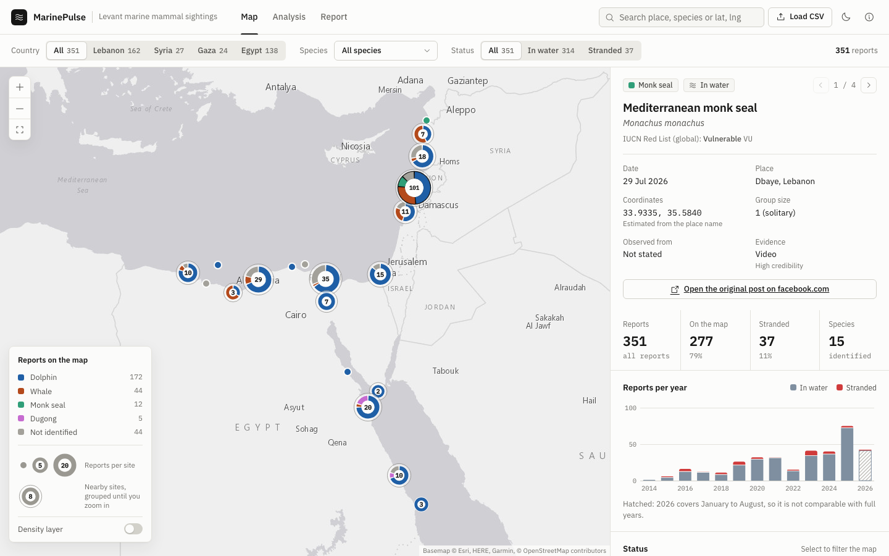
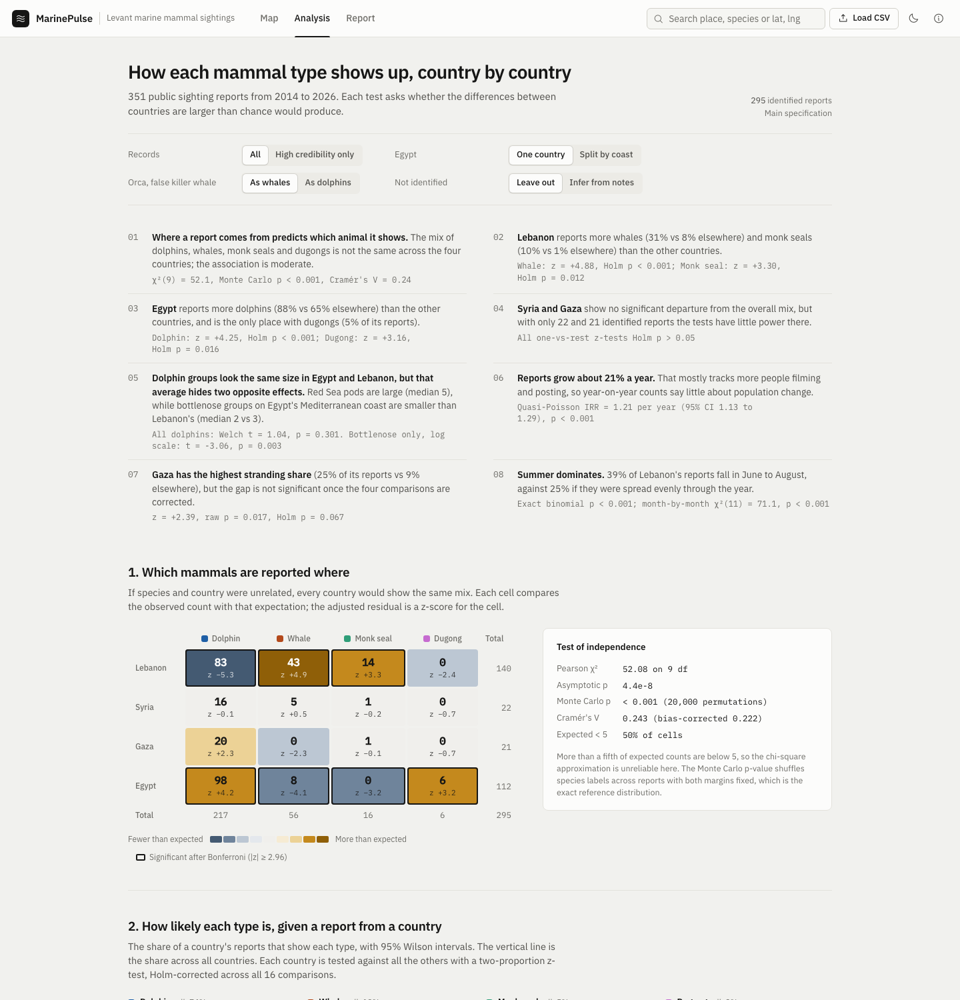

# MarinePulse: marine mammal sightings in the Levant

An interactive map and statistical analysis of 351 public reports of dolphins, whales, Mediterranean monk seals and dugongs from Lebanon, Syria, Gaza and Egypt (2014 to August 2026). Built during a research project for IMMRAC (Israeli Marine Mammal Research and Assistance Center).

The research question: **does each mammal type turn up differently from country to country, and are those differences larger than chance would produce?**



## Findings

| # | Finding | Evidence |
|---|---------|----------|
| 1 | The species mix differs between countries; the association is moderate. | Pearson chi-square(9) = 52.1, Monte Carlo p < 0.001 (100,000 permutations), Cramér's V = 0.24 |
| 2 | Lebanon reports far more whales (31% vs 8% elsewhere) and monk seals (10% vs 1%). | Adjusted residuals z = +4.9 and +3.3; two-proportion z-tests, Holm p < 0.001 and 0.012 |
| 3 | Egypt reports more dolphins (88% vs 65%) and is the only country with dugongs. | z = +4.2 and +3.2; Holm p < 0.001 and 0.016 |
| 4 | Syria and Gaza do not differ significantly from the overall mix, but with 22 and 21 identified reports the tests have little power. | All one-vs-rest Holm p > 0.05 |
| 5 | Dolphin groups look the same size in Egypt and Lebanon, but the average hides two opposite effects: Red Sea pods are large (median 5), while bottlenose groups on Egypt's Mediterranean coast are smaller than Lebanon's (median 2 vs 3). A composition effect of the Simpson's-paradox kind. | All dolphins: Welch t = 1.04, p = 0.30. Bottlenose only: Welch t on log size = -3.06, p = 0.003; Mann-Whitney p = 0.002 |
| 6 | Reports grow about 21% a year, which mostly tracks more people filming and posting. | Poisson regression of country-year counts, quasi-Poisson IRR = 1.21 (95% CI 1.13 to 1.29) |
| 7 | Gaza has the highest stranding share (25% vs 9%), but not significantly once four comparisons are corrected. | z = +2.39, raw p = 0.017, Holm p = 0.067 |
| 8 | Reports peak in summer: 39% of Lebanon's fall in June to August, against 25% expected. | Exact binomial p < 0.001 |

All counts describe *reports*, not animal populations. Reporting effort differs by country (observer platform differs significantly, Cramér's V = 0.19), season and year.



## Methods

| Question | Method |
|----------|--------|
| Is species mix independent of country? | Pearson chi-square test; Monte Carlo permutation p-value with both margins fixed (half the expected counts are below 5); Cramér's V with bias correction |
| Which cells drive it? | Haberman adjusted standardized residuals with a Bonferroni threshold (\|z\| > 2.96) |
| How likely is each type in each country? | Wilson score intervals; one-vs-rest two-proportion z-tests, Holm-corrected |
| How often is each type reported? | Exact (Garwood) Poisson intervals for reports per year, 2019 to 2025 |
| Is reporting increasing? | Poisson regression with country fixed effects; quasi-Poisson and negative binomial standard errors for overdispersion |
| Do group sizes differ? | Welch t-tests on raw and log scale, Mann-Whitney U, Kruskal-Wallis with Holm-corrected pairwise tests, Hedges' g |
| Strandings | Two-proportion z-tests, Monte Carlo test of independence, Fisher's exact test |
| Seasonality | Chi-square goodness of fit against a day-weighted uniform, exact binomial test for the summer share |

### Robustness

The main test is re-run under seven specifications. The association stays significant in all of them (Cramér's V 0.22 to 0.30):

- main specification
- high-credibility records only
- orca and false killer whale counted as dolphins (they are Delphinidae)
- unidentified reports assigned from field notes
- Egypt split into its Mediterranean and Red Sea coasts
- Mediterranean coasts only
- possible duplicate posts removed

## Data quality

The validation step (`analysis/output/08_data_issues.csv`) flags rows to fix in the source sheet:

- 3 empty template rows (sheet rows 353 to 355), excluded from the analysis
- 1 corrupted latitude (row 304, Batroun), kept but not mapped
- 1 unreadable date (row 171, "22/05/202")
- 9 possible duplicate posts sharing a source link (some are deliberate splits of mixed-species groups)

The share of reports without a species does not differ by country (p = 0.60), so leaving them out is unlikely to bias the country comparison.

## How it is built

```
index.html                     dashboard (Map, Analysis, Report views)
assets/data.js                 CSV parsing and cleaning (RFC 4180, quoted line breaks)
assets/stats.js                statistics library written from scratch (chi-square, t, z, Mann-Whitney, Poisson GLM, ...)
assets/analysis.js             the research design, recomputed live from any loaded CSV
assets/charts.js               hand-built SVG charts
assets/app.js                  map, filters, views
data/                          source CSV and an embedded copy so the page works offline
analysis/marine_mammal_stats.py  reference analysis in Python (pandas, SciPy, statsmodels)
analysis/output/               result tables, results.json, data issues
tests/validate_against_python.js  checks 254 browser results against the Python output
```

Category colours were chosen with a colour-blind safety check across all pairs (OKLab distance, protanopia and deuteranopia simulation) in both light and dark themes.

## Run it

Open `index.html` in a browser. Everything else is optional:

```bash
python3 -m http.server 3000            # serve locally, then open http://localhost:3000
pip install -r analysis/requirements.txt
python3 analysis/marine_mammal_stats.py # rebuild the tables in analysis/output
node tests/validate_against_python.js   # confirm the dashboard matches Python
node tools/embed_data.js                # refresh data/sightings.js after editing the CSV
```

A different sheet can be loaded with **Load CSV** or by dropping the file on the page; the map, analysis and report all update.

## Notes

- Conservation statuses are global IUCN Red List categories; Mediterranean subpopulations of some species (sperm whale, fin whale) are assessed separately and more severely.
- Basemap tiles: Esri World Gray Canvas.
